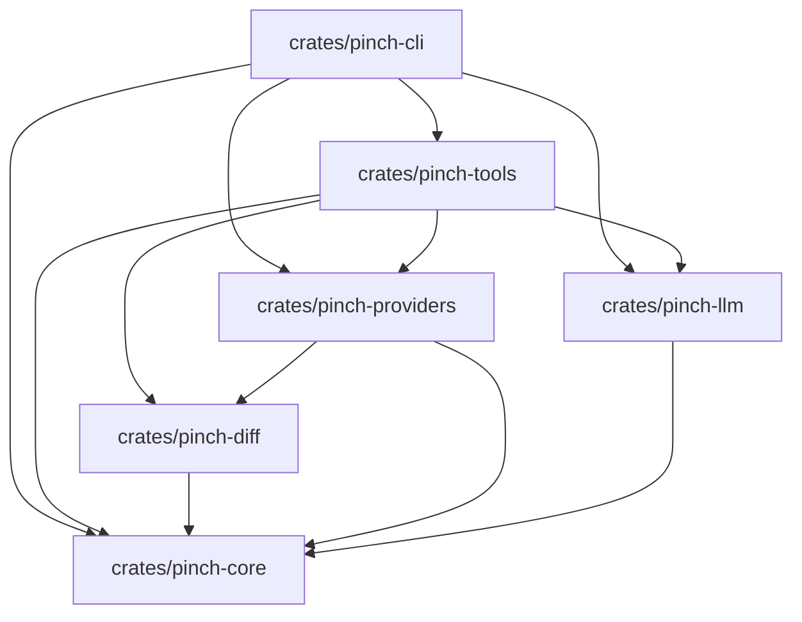

# PinchPR Architectural Specification & Implementation Plan

> **Project:** `pinch-pr` (pr-agent-rs)  
> **Target:** High-performance, asynchronous Rust port of [The-PR-Agent/pr-agent](https://github.com/The-PR-Agent/pr-agent)  
> **Status:** Core workspace implemented; CI, contributor, local-review, and draft-release workflows added.

---

## 1. Goals & Architectural Blueprint

* **Language & Edition:** Rust (2021 edition), async runtime powered by `tokio` (multi-threaded).
* **Binary Name:** `pinch-pr`
* **Architecture:** Modular Cargo workspace separating core domain models, diff processing & token budgeting, git provider abstractions, LLM client orchestration, review tools, and CLI entry point.
* **Reliability:** Zero unhandled panics or unwraps in library crates. Strict typed errors using `thiserror` for library crates and `anyhow` for top-level binaries and CLI runners.
* **Resilience:** Defensive against GitHub API quirks (e.g., 422 errors on invalid diff positions, PR commit SHA requirements) with graceful degradation to top-level comments.

---

## 2. Reference Mapping to `pr-agent` Python Implementation

| Responsibility | Python Reference (`pr-agent`) | Rust Target (`pinch-pr`) | Key Crates / Technologies |
| :--- | :--- | :--- | :--- |
| **Config Loader & Defaults** | `pr_agent/config_loader.py`, `settings/pr_agent.toml` | `crates/pinch-core/src/config.rs` | `config-rs`, `serde`, TOML / Env overrides |
| **Git Provider Abstraction** | `pr_agent/git_providers/git_provider.py` | `crates/pinch-core/src/traits.rs` (`GitProvider`) | `async-trait` |
| **GitHub Implementation** | `pr_agent/git_providers/github_provider.py` | `crates/pinch-providers/src/github.rs` | `octocrab`, `secrecy` |
| **Diff Parsing & Filtering** | `pr_agent/algo/pr_processing.py` | `crates/pinch-diff/src/parser.rs`, `filter.rs` | Git unidiff parser, ignore globs |
| **Token Budgeting** | `pr_agent/algo/token_handler.py` | `crates/pinch-diff/src/budget.rs` | `tiktoken-rs` (cl100k / o200k) |
| **LLM Client & JSON Parsing** | `pr_agent/algo/ai_handlers/litellm_ai_handler.py` | `crates/pinch-llm/src/client.rs` | `async-openai`, Structured Outputs + fallback |
| **Review Tool & Prompts** | `pr_agent/tools/pr_reviewer.py`, `settings/pr_reviewer_prompts.toml` | `crates/pinch-tools/src/review.rs` | Embedded templates (`include_str!`), Serde JSON |
| **CLI Runner** | `pr_agent/cli.py` | `crates/pinch-cli/src/main.rs` | `clap` (derive), `tracing`, `tracing-subscriber` |

---

## 3. Cargo Workspace & Crate Layout

```text
pinchpr/
├── Cargo.toml                  # Workspace manifest
├── docs/
│   └── plan.md                 # Architectural specification & execution plan
└── crates/
    ├── pinch-core/             # Shared domain models, configuration & async traits
    ├── pinch-diff/             # Git diff parser, ignore filters & token budget manager
    ├── pinch-providers/        # Git hosting provider implementations (GitHub via Octocrab)
    ├── pinch-llm/              # Async LLM client with Structured Outputs & OpenAI-compatible endpoints
    ├── pinch-tools/            # Review workflow, prompt formatting & review synthesis
    └── pinch-cli/              # Command-line interface (`pinch-pr`)
```

### Dependency DAG (Acyclic)



---

## 4. Deep-Dive Crate Specifications

### 4.1 `crates/pinch-core` (Domain Models & Core Traits)

* **Domain Models:**
  * `PullRequest`:
    * `number: u64`
    * `title: String`
    * `body: Option<String>`
    * `head_sha: String` *(Required for GitHub review submissions)*
    * `base_branch: String`
    * `head_branch: String`
    * `author: String`
  * `DiffFile`: File path (old/new), change status (`Added`, `Modified`, `Deleted`, `Renamed`), hunks vector.
  * `DiffHunk`: Header (`@@ -a,b +c,d @@`), old/new line bounds, vector of diff lines with line kinds (`Add`, `Delete`, `Context`).
  * `ReviewResult`: PR summary, complexity score, list of `ReviewIssue` (type, description, severity), and vector of `InlineComment`.
  * `InlineComment`: `path: String`, `side: CommentSide` (`Left` / `Right`), `line: u32`, `start_line: Option<u32>`, `body: String`.

* **Async Traits:**
  ```rust
  #[async_trait]
  pub trait GitProvider: Send + Sync {
      /// Fetch PR metadata including head commit SHA, branch names, and description
      async fn get_pr(&self, pr_number: u64) -> Result<PullRequest, ProviderError>;

      /// Fetch raw unified diff for the PR
      async fn get_pr_diff(&self, pr_number: u64) -> Result<String, ProviderError>;

      /// Post a general top-level comment to the PR discussion
      async fn publish_comment(&self, pr_number: u64, body: &str) -> Result<(), ProviderError>;

      /// Publish a structured review with inline comments against the PR head commit
      async fn publish_review(&self, pr_number: u64, review: &ReviewResult) -> Result<(), ProviderError>;
  }

  #[async_trait]
  pub trait LlmClient: Send + Sync {
      /// Generate structured responses adhering to JSON Schema / DeserializeOwned
      async fn generate_structured<T: serde::de::DeserializeOwned + Send>(
          &self,
          system: &str,
          user: &str,
      ) -> Result<T, LlmError>;

      /// Generate plain text completion
      async fn generate_text(&self, system: &str, user: &str) -> Result<String, LlmError>;
  }
  ```

---

### 4.2 `crates/pinch-diff` (Diff Engine & Token Budgeting)

* **Git Diff Parsing:**
  * Parse standard Git unified diffs including extended headers (`diff --git`, `index`, `new file mode`, binary marker `Binary files differ`).
  * Index all valid new line numbers (`RIGHT` side) and old line numbers (`LEFT` side) within diff hunks to enable strict line-position validation for inline comments.
* **Ignore Filters:**
  * Auto-ignore lockfiles (`Cargo.lock`, `package-lock.json`, `uv.lock`, `yarn.lock`, `pnpm-lock.yaml`, `poetry.lock`).
  * Ignore binary files, SVGs, minified bundles (`*.min.js`, `*.min.css`), and vendored paths.
* **Token Budget Manager (`tiktoken-rs`):**
  * Support model encodings: `cl100k_base` (GPT-4/GPT-3.5) and `o200k_base` (GPT-4o).
  * Calculate token overhead: reserved completion tokens (e.g. 2,500 tokens) + prompt instructions + PR metadata.
  * Hierarchical Pruning Strategy:
    1. Filter out ignored files completely.
    2. Sort files by priority (core source files > configuration > documentation).
    3. If total tokens exceed context budget, truncate hunk bodies of lower-priority files while keeping file headers with clear markers: `[Diff omitted: file exceeded token budget]`.

---

### 4.3 `crates/pinch-providers` (GitHub Provider via Octocrab)

* **Authentication:**
  * Initialize `octocrab::Octocrab` via `GITHUB_TOKEN` environment variable or explicit config.
* **PR Metadata & Diff Fetching:**
  * Query PR details: `octocrab.pulls(owner, repo).get(pr_number)`.
  * Retrieve raw diff using `octocrab.pulls(owner, repo).get_diff(pr_number)`.
* **Resilient Review Publishing:**
  * GitHub API requirement: Inline comments require `commit_id = pr.head_sha`.
  * Line Validation: Before publishing, filter all `InlineComment` instances against valid hunk lines from `pinch-diff`.
  * **Fallback Degradation:** If `publish_review` encounters an HTTP 422 error (e.g. position out of diff scope), fall back to publishing the main review body with an appended `"### Inline Suggestions"` section via `publish_comment`.

---

### 4.4 `crates/pinch-llm` (LLM Orchestration)

* **Flexible Endpoints:**
  * Powered by `async-openai`.
  * Configurable `base_url` (defaults to OpenAI, but seamlessly supports Ollama, vLLM, Groq, Together, DeepSeek, and OpenRouter).
* **Dual Parsing Strategy:**
  1. *Primary:* Request structured output via `ResponseFormat::JsonSchema` or `ResponseFormat::JsonObject`.
  2. *Fallback:* If the model or endpoint returns plain text wrapped in markdown code fences (` ```json ... ``` `), strip fences with robust regex extraction before deserializing via `serde_json`.

---

### 4.5 `crates/pinch-tools` (Review Tool & Prompt Engine)

* **Prompt Engineering:**
  * Built-in default prompt templates embedded into binary via `include_str!("../prompts/review_system.md")` and `include_str!("../prompts/review_user.md")`.
  * Optional runtime overrides via configuration.
* **Review Pipeline:**
  1. Fetch PR metadata (`get_pr`) and diff (`get_pr_diff`).
  2. Parse diff into file/hunk trees and prune using token budget manager.
  3. Format prompt with PR title, description, and budgeted diff.
  4. Query `LlmClient::generate_structured::<ReviewPayload>`.
  5. Validate inline suggestions against diff hunks.
  6. Dispatch review via `GitProvider::publish_review` (or print if dry-run).

---

### 4.6 `crates/pinch-cli` (CLI Interface `pinch-pr`)

* **Commands & Arguments:**
  ```bash
  # Standard review
  pinch-pr review --repo owner/repo --pr 42

  # Dry-run review (prints output without calling GitHub mutate APIs)
  pinch-pr review --repo owner/repo --pr 42 --dry-run

  # Specify custom model and JSON output
  pinch-pr review --repo owner/repo --pr 42 --model gpt-4o-mini --format json
  ```
* **Flags:**
  * `--repo <owner/repo>`: Target repository.
  * `--pr <number>`: Pull request number.
  * `--dry-run`: Evaluate diff, generate LLM review, print to stdout without posting comments.
  * `--model <name>`: Override default model.
  * `--format <markdown|json>`: Output presentation style.
  * `-v, --verbose`: Enable debug / trace logging.

---

## 5. Required Dependencies

| Category | Crates | Purpose |
| :--- | :--- | :--- |
| **Async Runtime** | `tokio = { version = "1.40", features = ["full"] }`, `async-trait = "0.1"` | Async execution & dynamic traits |
| **Git API** | `octocrab = { version = "0.41", features = ["rustls"] }` | GitHub REST API client |
| **LLM & Tokens** | `async-openai = "0.26"`, `tiktoken-rs = "0.5"` | LLM API queries and BPE token budgeting |
| **Serialization** | `serde = { version = "1.0", features = ["derive"] }`, `serde_json = "1.0"`, `toml = "0.8"` | Structured JSON/TOML parsing |
| **Config & CLI** | `clap = { version = "4.5", features = ["derive", "env"] }`, `config = "0.14"` | CLI parsing and hierarchical settings |
| **Error & Logging** | `thiserror = "1.0"`, `anyhow = "1.0"`, `tracing = "0.1"`, `tracing-subscriber = { version = "0.3", features = ["env-filter"] }` | Structured error handling and telemetry |

---

## 6. Phased Execution Roadmap

*This roadmap records the original implementation sequence.*

1. **Phase 1: Workspace & Core Crates (`pinch-core`)**
   - Initialize root `Cargo.toml` workspace.
   - Define domain data structures (`PullRequest`, `DiffFile`, `ReviewResult`, etc.).
   - Define `GitProvider` and `LlmClient` traits.
   - Implement configuration loader with environment variable overrides.

2. **Phase 2: Diff Engine (`pinch-diff`)**
   - Implement Git unified diff parser with hunk and line tracking.
   - Implement ignore filters (lockfiles, binaries, minified assets).
   - Implement token counting and hunk budget pruning using `tiktoken-rs`.
   - Write comprehensive unit tests with fixture diffs.

3. **Phase 3: LLM Integration (`pinch-llm`)**
   - Implement `async-openai` client with configurable `base_url` and API keys.
   - Implement structured output deserialization and markdown fence stripping fallback.
   - Add unit tests for schema parsing and JSON repair.

4. **Phase 4: GitHub Provider (`pinch-providers`)**
   - Implement `octocrab` wrapper for PR metadata, diffs, and review submissions.
   - Wire commit SHA tracking (`head_sha`).
   - Implement diff line validation and fallback degradation from 422 errors.

5. **Phase 5: Review Tool Logic (`pinch-tools`)**
   - Embed review prompt templates.
   - Build review orchestration pipeline (`fetch` -> `prune` -> `query` -> `format`).
   - Format GitHub markdown tables and inline comment payloads.

6. **Phase 6: CLI Runner & Testing (`pinch-cli`)**
   - Implement `clap` CLI with `--dry-run`, `--repo`, `--pr`, and `--model`.
   - Setup `tracing_subscriber` logging.
   - End-to-end dry-run verification against public GitHub pull requests.

## 7. Git Workflow Plan

This roadmap covers four related workflows: repository CI, contributor collaboration, tagged releases, and reviewing local Git changes. The first three improve how the project is developed and shipped; local review is a user-facing product capability and should reuse the existing review pipeline without pretending a local repository is a GitHub pull request.

### 7.1 Continuous Integration

Add a GitHub Actions workflow at `.github/workflows/ci.yml`.

* **Triggers:** Pull requests targeting `master` and pushes to `master`.
* **Runner and toolchain:** Ubuntu with the stable Rust toolchain, plus the official `rustfmt` and `clippy` components. Pin the toolchain action to a maintained major version.
* **Checks:** Run `cargo fmt --all -- --check`, `cargo clippy --workspace --all-targets --locked -- -D warnings`, `cargo test --workspace --locked`, and `cargo build --workspace --locked`.
* **Efficiency and permissions:** Cache Cargo downloads/build artifacts; cancel superseded runs for the same branch or pull request; grant read-only repository permissions. CI must not need GitHub or LLM credentials, and tests must not make live service calls.
* **Acceptance:** A pull request cannot be considered merge-ready until all checks pass. Confirm that formatting, lint, test, and build failures each fail the workflow.

### 7.2 Contributor Git Process

Document a lightweight branch-and-pull-request convention in the README or a focused contributing guide.

1. Start from an up-to-date `master`; use short-lived branches named by intent, such as `feat/local-review`, `fix/diff-parser`, or `docs/contributing`.
2. Keep commits focused and explain the motivation in their messages. Do not require a specific commit-message standard until maintainers choose one.
3. Open a pull request against `master` with a summary, linked issue when applicable, test commands/results, and any user-visible or breaking changes.
4. Require the CI checks from section 7.1 before merge. Prefer squash merging to keep the mainline history readable; protect `master` with required checks and restrict force pushes/deletion where repository settings permit.
5. Keep tokens, provider credentials, and generated build output out of commits.

Add a pull request template under `.github/` to collect the summary, validation, and risk information. Configure branch protection as a repository setting; a workflow file alone cannot enforce it.

### 7.3 Tagged Release Workflow

Start with GitHub Releases for distributing the CLI. Keep publication to crates.io out of the initial automation until workspace crate metadata and inter-crate version/dependency requirements are explicitly validated.

1. On a release PR, update the workspace version consistently, add release notes, and verify CI.
2. After merge, create and push a `vX.Y.Z` tag corresponding to the workspace version.
3. Add `.github/workflows/release.yml`, triggered only by version tags. It should check out the tagged source, run locked tests, and build optimized CLI binaries for the initially supported Linux, macOS, and Windows targets.
4. Package each binary with a short usage/installation note, generate SHA-256 checksums, and upload the archives and checksums to a draft GitHub Release.
5. Require a maintainer to review and publish the draft. Do not publish from arbitrary branch pushes or expose long-lived credentials; use the workflow-provided token with the minimum permissions required.

**Acceptance:** A test tag produces one draft release with the expected target artifacts and verifiable checksums; a non-version tag or ordinary push does not publish artifacts.

### 7.4 Local Git Review Feature

Add local branch review as a separate CLI input path, sharing diff parsing, filtering, token budgeting, LLM analysis, and report rendering with the existing GitHub PR review path.

* **MVP command:** `pinch-pr review-local --repo-path <path> --base <ref>`. Compare the merge-base of `<base>` and the checked-out `HEAD` with `HEAD`, so the report covers the branch's committed changes relative to its base. Resolve refs and paths within the selected repository, and report Git errors clearly.
* **Local data source:** Extract a shared analysis input boundary rather than implementing a fake `GitProvider` whose publication methods silently do nothing. Supply local branch/ref metadata and a unified diff to the shared review pipeline. Keep local reviews report-only; do not make GitHub mutations.
* **Git invocation:** Prefer the installed Git executable for the first implementation, invoked with argument arrays (never through a shell). Validate repository paths/refs, handle missing Git, invalid refs, empty diffs, renames, and binary files explicitly, and avoid changing the user's index, working tree, or repository state.
* **Output and secrets:** Reuse Markdown/JSON output formats. Local review still requires configured LLM access, but must not require a GitHub token.
* **Tests:** Cover clean/no-change branches, divergent base refs, renames, binary and ignored files, invalid paths/refs, missing Git, and proof that review does not modify repository state. Keep Git and LLM integration tests isolated from external services.
* **Follow-up scope:** Consider staged, unstaged, and untracked working-tree changes only after the branch-review MVP has stable diff and safety semantics; define how untracked files enter the diff before implementing that mode.

### 7.5 Delivery Order

1. **Complete:** Add CI and make its checks pass on the current workspace.
2. **Complete:** Add the contributor guide and pull request template. Maintainers still need to configure branch protection and merge settings.
3. **Complete:** Implement local branch review and its isolated tests, then document the CLI command.
4. **Implemented, pending first tagged run:** Add draft binary releases for Linux, macOS, and Windows.
5. **Deferred:** Revisit crates.io publishing as a separate decision after validating package metadata and dependency versioning.
